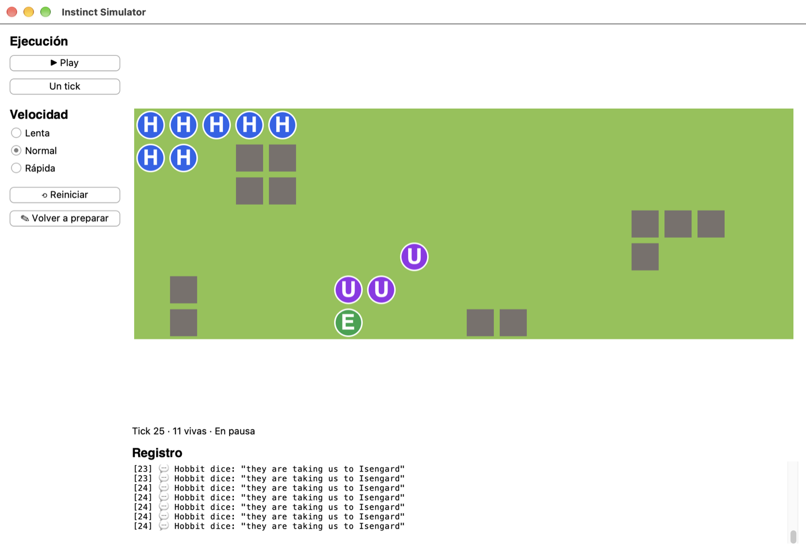
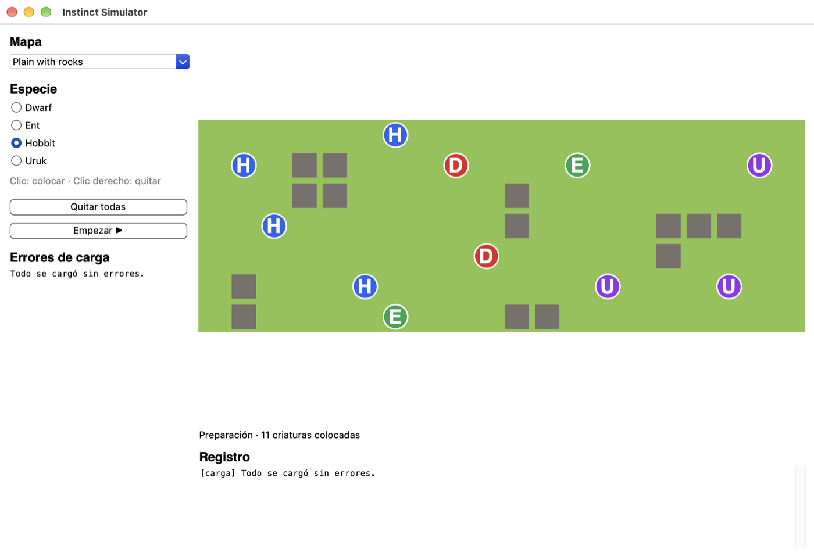
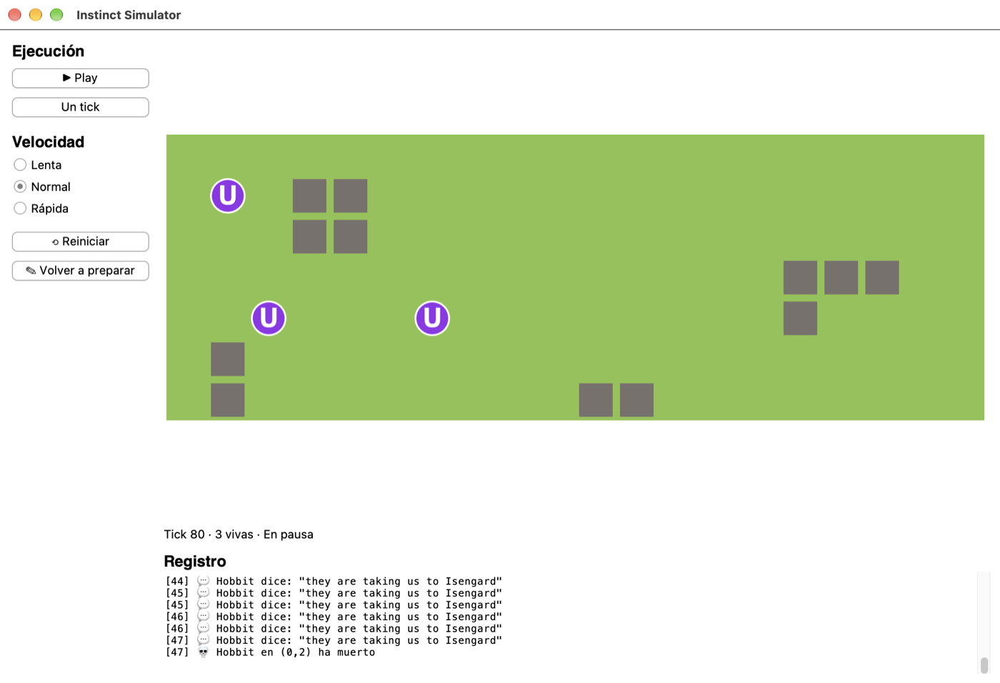

# Instinct Simulator

Intérprete del lenguaje **Instinct** y simulador de un mundo de criaturas, hecho en Python para el proyecto de Programación Orientada a Objetos.

Cada especie se programa en un archivo `.ins` con su "instinto": un bucle de condiciones y saltos que decide, turno a turno, si moverse, atacar, comer, reproducirse o rugir según lo que percibe. La aplicación carga criaturas, terrenos, objetos y mapas desde `data/`, deja colocar criaturas sobre un mapa y muestra la simulación en tiempo real.



## Cómo ejecutarlo

Requiere **Python 3.10 o superior con Tkinter 8.6**. El Python que trae macOS (`/usr/bin/python3`) usa Tk 8.5 y la ventana se queda en blanco. En Mac con Homebrew:

```bash
brew install python-tk@3.12
```

| Qué | Comando |
|---|---|
| Interfaz gráfica | `python3.12 gui.py` |
| Simulación en la terminal, sin interfaz | `python3.12 main.py` |
| Tests (`unittest`, sin dependencias) | `python3.12 -m unittest discover -s tests -t .` |

## Uso

### 1. Preparación



- Elige un **mapa** en el desplegable.
- Marca una **especie** y haz **clic** en una casilla para colocarla. **Clic derecho** (o Ctrl+clic) la quita.
- No se puede colocar sobre un objeto ni sobre otra criatura.
- Abajo se ven los **errores de carga**: los archivos de `data/` que no compilaron, con su línea. La aplicación sigue funcionando con los demás.

### 2. Ejecución

- **Play / Pausa**, **Un tick** y tres **velocidades** (lenta, normal y rápida).
- **Reiniciar** vuelve al tick 0 con las mismas criaturas. Como la semilla es la misma, la partida se repite idéntica.
- **Volver a preparar** regresa a la preparación con las criaturas que habías colocado.
- Durante la ejecución no se puede tocar el mundo: solo el tiempo.

### 3. Registro



El registro muestra los errores de carga al arrancar y, durante la simulación, los rugidos, lo que dicen las criaturas, las muertes, los objetos destruidos y los errores de ejecución (con su línea). Cada evento lleva el número de tick.

La ventana se puede **redimensionar**: el mapa ajusta el tamaño de las casillas al espacio disponible.

## El lenguaje Instinct

```
creature Hobbit
faction shire
health 60
vision 5
lifespan 300

start:
if enemy_dist >= 0 goto flee
if reserve_here > 0 and health < 80 goto eat
move(random % 3 - 1, random % 3 - 1, 1)
goto start

flee:
say("they are taking us to Isengard")
move(-enemy_dx, -enemy_dy, 2)
goto start

eat:
consume(0, 0, 10, 10)
goto start
```

- **Acciones:** `move`, `attack`, `consume`, `reproduce`, `roar`, `say`, `wait`. Todas gastan el turno salvo `say`.
- **Funciones:** `see(x, y)` y `name(x, y)`.
- **Constantes:** `NONE`, `GROUND`, `OBJECT`, `ALLY`, `ENEMY`.
- **Percepciones** (solo lectura): sobre la propia criatura (`health`, `x`, `terrain_here`...), sobre el mundo (`tick`, `total_allies`...) y sobre su entorno (`enemy_dist`, `enemy_dx`, `roars_near`...).
- **Errores de compilación**, detectados al cargar: etiqueta inexistente o duplicada, cabecera incompleta, asignar a una percepción, número de argumentos incorrecto...
- **Errores de ejecución**, que matan a la criatura y quedan en el registro: división por cero, variable sin asignar, tipos mezclados, `dx`/`dy` fuera de `{-1, 0, 1}`...

## Arquitectura

```
src/
  language/     lexer → parser → AST → intérprete
  world/        mundo, casillas, terreno, objetos y criaturas
  simulation/   el bucle de ticks
  loaders/      lectura de data/ con errores por archivo y línea
  ui/           interfaz en Tkinter
data/           criaturas (.ins), terrenos (.te), objetos (.ob) y mapas (.map)
tests/          tests de lexer, parser, acciones, percepciones y simulación
```

### Decisiones de diseño

**El intérprete recorre el AST con polimorfismo, sin cadenas de `if`.** Cada nodo sabe evaluarse (`Expression.evaluate`) o ejecutarse (`Instruction.execute`), y valida sus propios errores de compilación con `check`.

**Acciones.** Una clase abstracta `Action` y una subclase por acción, registradas en `ACTION_REGISTRY`. Añadir una acción nueva es escribir una clase y añadir una línea al registro, sin tocar el intérprete.

**Percepciones.** Un registro `{nombre: Percepción}` con pocas clases parametrizadas: `CreatureAttr("health")`, `Count(filtro, solo_visibles)`, `Nearest(búsqueda, componente)`... en lugar de treinta `if nombre == ...`. Se calculan **al comienzo de cada turno**, salvo `random`, que es *viva* (`live = True`) y cambia en cada lectura. La lista de percepciones protegidas del parser se deriva del propio registro, así que hay una única fuente de verdad.

**Lo que vive en el mundo.** Una jerarquía con `Entity` como base abstracta (`take_damage`, `is_depleted`):

```
Entity
├── ReserveEntity  (name, char, reserva)
│   ├── Terrain    (+ regen)
│   └── WorldObject
└── Creature       (el golpe le quita vida)
```

`attack` y `consume` llaman a `take_damage` sobre lo que hay en la casilla, sin preguntar qué es.

**Simulación separada de la interfaz.** `Simulation` no sabe que existe Tkinter: `main.py` corre una partida completa en la terminal. La interfaz solo llama a `tick()` y `reset()` y **lee** el estado (`world`, `tick_count`, `is_over`, `events_since`). La simulación trabaja sobre una copia del mundo preparado, y por eso reiniciar es volver a copiarlo.

**Toda la aleatoriedad sale de un solo generador con semilla**: `random` y el orden de los turnos. La misma semilla da la misma partida.

**La carga nunca tira la aplicación.** Cada archivo se carga por separado. Si falla, el error se guarda con su archivo y línea, y la aplicación sigue con los demás.

**La interfaz dibuja lo que no conoce.** Terrenos, objetos y facciones nuevos reciben un color por defecto, y los terrenos y objetos desconocidos muestran su `char` para poder distinguirlos.

## Tests

Hay tests del lexer, del parser (incluidas las cuatro criaturas de ejemplo y todos los errores de compilación), de cada acción, de las percepciones, del intérprete y de la simulación (fin de tick, rugidos, reinicio, semilla...).

```bash
python3.12 -m unittest discover -s tests -t . -v
```

## Autor

Josué Alejandro Tamayo Ayrado. Licencia MIT.
